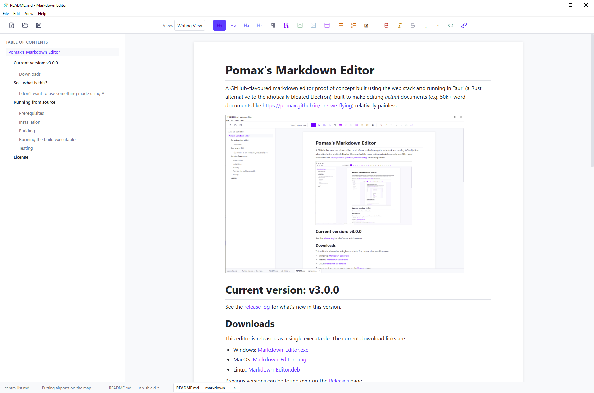

# Pomax's Markdown Editor

A GitHub-flavoured markdown editor proof of concept built using the web stack and running in Tauri (a Rust alternative to Electron), built to make editing _actual_ documents (e.g. 50k+ word documents like [https://pomax.github.io/are-we-flying](https://pomax.github.io/are-we-flying)) relatively painless.



## Current version: v3.1.0

See the [release log](./RELEASE_LOG.md) for what's new in this version.

### Downloads

This editor is released as a single executable. The current download links are:

- Windows: [Markdown-Editor.exe](https://github.com/Pomax/Pomax-s-Markdown-Editor/releases/download/v3.1.0/Markdown-Editor.exe)
- MacOS: [Markdown-Editor.dmg](https://github.com/Pomax/Pomax-s-Markdown-Editor/releases/download/v3.1.0/Markdown-Editor.dmg)
- Linux: [Markdown-Editor.deb](https://github.com/Pomax/Pomax-s-Markdown-Editor/releases/download/v3.1.0/Markdown-Editor.deb)

Previous versions can be found over on the [Releases](https://github.com/Pomax/Pomax-s-Markdown-Editor/releases/latest) page.

Alternatively, of course, you can just clone the repo, install all the dependencies, and then run the start script from the `scripts` directory.

## So... what is this?

I needed a standalone, GitHub flavoured markdown editor that can open individual files, has both wysiwyg and plain source modes with seamless toggling between those, has *full* "arbitrary html in markdown" support, _including stylesheets_, and the ability to load 50,000+ word documents in a way that edits are (near) immediate instead of trying to update a single, giant, string. Which rules out literally every markdown editor out there. Think of your favourite markdown editor: it fails at least one of those criteria.

So this is that. It's a markdown editor that does what I need.

### Features

- Wysiwyg as well as source view edit modes 
  - Optional wysiwyg button bar for those who want it.
- Full GFM support, including regular HTML because that's literally part of GFM.
  - That includes checkbox list support
  - And the `<details>` element.
- ToC based on your headings
- Open as many files as you want
- This editor will not get slower the larger your document is.
- LaTeX math support (using LaTeX delimiters, not TeX delimiters), but onl
  - (only blocks only for now, because inline math is bad math)

## Running from source

There are prebuilt executables, but if you want to run the project from source, compiled on your own machine, go for it.

### Prerequisites

All platforms:

- Git, with the Unix tools install if you're on Windows
- A currently supported version of Node.js (I recommend using [nvm](https://www.nvmnode.com/guide/download.html))
- [Rust](https://rust-lang.org/tools/install)

Build tools:

- On Windows, the [Microsoft C++ Build Tools](https://visualstudio.microsoft.com/visual-cpp-build-tools/) (with the "Desktop development with C++" workload installed) and for Windows 10, the [WebView2 runtime](https://developer.microsoft.com/en-us/microsoft-edge/webview2/) component.
- on macOS, the Xcode command line tools (`xcode-select --install` if not already installed)
- on Linux, `sudo apt-get update && sudo apt-get install -y libwebkit2gtk-4.1-dev build-essential libxdo-dev libssl-dev libayatana-appindicator3-dev librsvg2-dev xvfb openbox`.

### Installation

```sh
npm install --ignore-scripts
npm run setup
```

The setup script installs the Playwright Firefox browser used for browser testing, so it's technically optional if all you want to do is compile the editor, but like... you might as well, so you can run the tests to make sure everything works?

### Building

For Windows users, run `scripts\build.bat`, for MacOS and Linux, run `./scripts/build.sh`

### Running the build

For Windows users, run `scripts\run.bat`, for MacOS and Linux, run `./scripts/run.sh`

### Testing

You run the regular test suite using the `scripts\test.bat` or `./scripts/test.sh` scripts. Nice and simple. This will run linting, formatting, consistency testing, unit testing, the backend's Rust tests, integration testing, and browser testing.

To also run the real app tests, run `npm run test:real-input`. This will either hijack your real keyboard and mouse to drive the app, or it'll try to use virtual input devices and you're probably going to be told by your OS that you need to do one or more things to allow these tests to actually run correctly.

## License

I didn't write this code, and AI is just an autocomplete algoirhtm that looks at the previous _million_ rather than "several" words to come up with the statistically most likely next word, so there is nothing to copyright or license here. This project is Public Domain.
