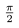
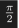
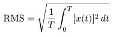
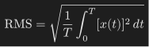

# math-render

LaTeX math → SVG, entirely in Rust.

```rust
let svg: Vec<u8> = math_render::render_svg(r"\frac{\pi}{2}", false, "#000000")?;
```

| `color: "#000000"` | `color: "#e6e6e6"` |
|---|---|
|  |  |

Pure Rust: no LaTeX install, no system font dependency. Under the hood:
[`mitex`](https://github.com/mitex-rs/mitex) converts LaTeX math source to
Typst math source, [`typst`](https://github.com/typst/typst)/`typst-as-lib`
compiles it, and [`typst-svg`](https://github.com/typst/typst) exports the
result as a standalone SVG. Fonts come from `typst-kit`'s embedded set, not
the host system, so output is reproducible across machines.

## Usage

```rust
use math_render::render_svg;

// Inline style: $...$ / \(...\)
let inline = render_svg(r"\frac{\pi}{2}", false, "#000000")?;

// Display style: $$...$$ / \[...\] — handles \sqrt, \int with bounds,
// and \text{...} in one formula (continuous-signal RMS):
let display = render_svg(
    r"\text{RMS} = \sqrt{\frac{1}{T} \int_{0}^{T} [x(t)]^2 \, dt}",
    true,
    "#000000",
)?;
```

| `color: "#000000"` | `color: "#e6e6e6"` |
|---|---|
|  |  |

* `tex` is the LaTeX math source without surrounding delimiters.
* `color` is the text color as a hex string (e.g. `"#000000"`) — the page background is always transparent.
* The returned bytes are a standalone SVG document sized to fit the formula exactly (no page padding beyond a small margin).

The images above add a background rectangle on top of that transparent output, so the same formula is legible on both light and dark backgrounds.

## Why not [MathJax](https://www.mathjax.org/) / [KaTeX](https://katex.org/) / a LaTeX toolchain?

Those are excellent, but pull in a JS runtime or a full LaTeX
installation. This crate's only non-Rust dependency is a small set of
vendored Typst spec files (see [`vendor/mitex/NOTICE.md`](vendor/mitex/NOTICE.md))
that supply `mitex`'s runtime helper functions — everything else is a Rust
crate, so `cargo build` is enough.

## Status

Early — the API is a single function. It covers the common LaTeX math
subset that `mitex` supports; anything `mitex::convert_math` can't
translate to Typst will surface as an error rather than silently
mis-rendering.

## License

Licensed under either of [Apache License, Version 2.0](LICENSE-APACHE) or
[MIT license](LICENSE-MIT) at your option.

`vendor/mitex/` contains files vendored from the
[mitex](https://github.com/mitex-rs/mitex) project, licensed Apache-2.0 —
see [`vendor/mitex/NOTICE.md`](vendor/mitex/NOTICE.md) for details.
